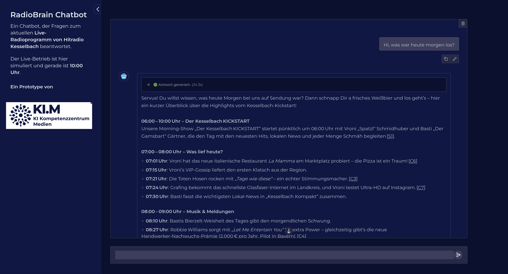

🇩🇪 Deutsch | [🇬🇧 English](README.en.md)

# KI-gestützte vollautomatisierte Hörerkommunikation

> [!IMPORTANT]
> Dies ist eine Proof-of-Concept-Umsetzung einer KI-gestützten, vollautomatisierten Hörerkommunikation für Radiosender. Sie nutzt eine Kombination aus Retrieval-Augmented Generation (RAG) und Großen Sprachmodellen (LLMs), um Hörerinnen und Hörer mit Informationen über den Sender, seine Programme und weitere verwandte Themen zu versorgen.

> [!WARNING]
> Erwarten Sie keinen produktionsreifen Code. Es handelt sich um einen Forschungsprototypen, der die Fähigkeiten von LLMs und RAG-Systemen im Kontext von Radiosendern demonstriert. Nutzung auf eigene Gefahr.



## Setup
- Installieren Sie Docker und Docker-Compose auf Ihrer Plattform.
- Installieren Sie Poetry: https://python-poetry.org/docs/#installing-with-the-official-installer
- Klonen Sie dieses Repository mit git.
- Installieren Sie die Abhängigkeiten: `poetry install`
- Richten Sie das erforderliche LLM-Backend ein (siehe [LLM HOWTO](LLM-HOWTO.md))
- Stellen Sie sicher, dass das Embedding-Modell `granite-embedding:278m` lokal in Ollama läuft.
- Bearbeiten Sie die `config-kesselbach.yaml`, um sich mit der vLLM- oder Ollama-Instanz zu verbinden, die `gpt-oss:120b` ausführt, und legen Sie Benutzername und Passwort für die Anwendung fest.
- Führen Sie `make reloaddb` aus, um die Datenbank zu initialisieren und die Beispieldaten aus dem Verzeichnis `data` zu laden.

## Anwendung starten
Starten Sie die Anwendung mit:
```bash
make build
make start
```

Zum Beenden der Anwendung führen Sie aus:
```bash
make stop
```

Die Anwendung ist anschließend unter `http://127.0.0.1:7860` erreichbar.

## Anwendung anpassen

Sie können die Anwendung für Ihren Radiosender anpassen.

### Eigene Daten

Wir stellen Beispiel-Transkripte (bereits gechunkt), Website- und Playlist-Daten im Verzeichnis `data` bereit. Sie können diese Dateien durch eigene Daten im selben Format ersetzen. Führen Sie anschließend `make reloaddb` aus, um die Datenbank mit Ihren Daten neu zu laden.

### Eigene Prompts

Sie müssen die Prompts in der Datei `src/llm/prompts.py` anpassen. Die Prompts werden zur Generierung der Antworten des LLM verwendet. Sie können die Prompts an den Stil und Ton Ihres Radiosenders anpassen.

### Eigene feste Daten

An mehreren Stellen der Anwendung können Sie Inhalte bereitstellen und Ausgaben konfigurieren.

#### Streams
Feste Stream-Link-Daten stellen wir in der Datei `src/streams.json` bereit. Sie können diese Datei durch eigene Daten im selben Format ersetzen. Die Anwendung nutzt diese Daten, um die Stream-Links des Radiosenders zu generieren.

#### Automatische Antworten
Optionen für automatische Antworten im Fall einer Ablehnung finden Sie in `src/constants.py`.

#### Basisdaten des Radiosenders
Weitere feste Daten und Konstanten im Zusammenhang mit dem Radiosender finden Sie in der `config.yaml`.

## Testsuite ausführen

Wir stellen eine Beispiel-Testsuite bereit, um die Qualität der Anwendung zu messen. Die Testsuite enthält Tests für verschiedene Komponenten der Chatbot-Anwendung, etwa den LLM-basierten Filter und das RAG-System.
Bearbeiten Sie die Datei `eval-config.yaml`, um die Testsuite anzupassen. Sie können die Testfälle, die Anzahl der Testfälle und die Konfiguration des LLM-basierten Filters ändern. Die mitgelieferte Testsuite ist nicht abschließend und kann um weitere Szenarien erweitert werden. Sie ist ein guter Ausgangspunkt, um die Qualität der Anwendung sicherzustellen. Die für die Tests verwendeten Beispieldaten liegen in `src/eval/` und können leicht um weitere Testfälle erweitert werden.

Sie können die Testsuite ausführen mit (erfordert eine lokale Ollama-Instanz mit dem Embedding-Modell `granite-embedding:278m` sowie eine lokale Version von `gpt-oss:120b`):

```bash
make eval-docker
```

## Lizenz

Dieses Projekt ist unter der MIT-Lizenz lizenziert – siehe die Datei [LICENSE](LICENSE) für Details.
Der Prototyp ist für die Nutzung durch Medienunternehmen gedacht.

Copyright (c) 2026 Medien.Bayern GmbH.

## Mitwirkende
Originalentwicklung durch die Medien.Bayern GmbH ([KI.M](https://www.kim-bayern.de/)) in Zusammenarbeit mit [Tobias Sterbak](https://tobiassterbak.com).

## Ein Projekt des KI-Kompetenzzentrum Medien (KI.M)
Das KI-Kompetenzzentrum Medien (KI.M) ist der zentrale Hub für künstliche Intelligenz in der bayerischen Medienbranche. Wir unterstützen Medienunternehmen dabei, KI-Lösungen zu adoptieren, die rechtskonform, zukunftssicher und auf datensouveräner Infrastruktur aufbauen.

Wir bieten unabhängige Informationen und praxisnahe Demonstrationen der Fähigkeiten und Grenzen von KI in Medienanwendungen. In unserem AI Lab arbeiten wir mit Partnern zusammen, um reale Implementierungen zu erproben. Unsere Machbarkeitsstudien veröffentlichen wir als Berichte auf unserer Website, die technischen Grundlagen und den Code teilen wir hier in unseren Repositories.

Der KI.M ist eine gemeinsame Initiative der Bayerischen Landeszentrale für neue Medien (BLM) und der Medien.Bayern GmbH, unterstützt von der Bayerischen Staatskanzlei.

**Mehr erfahren:** [Besuchen Sie unsere Website](https://www.kim-bayern.de/)


