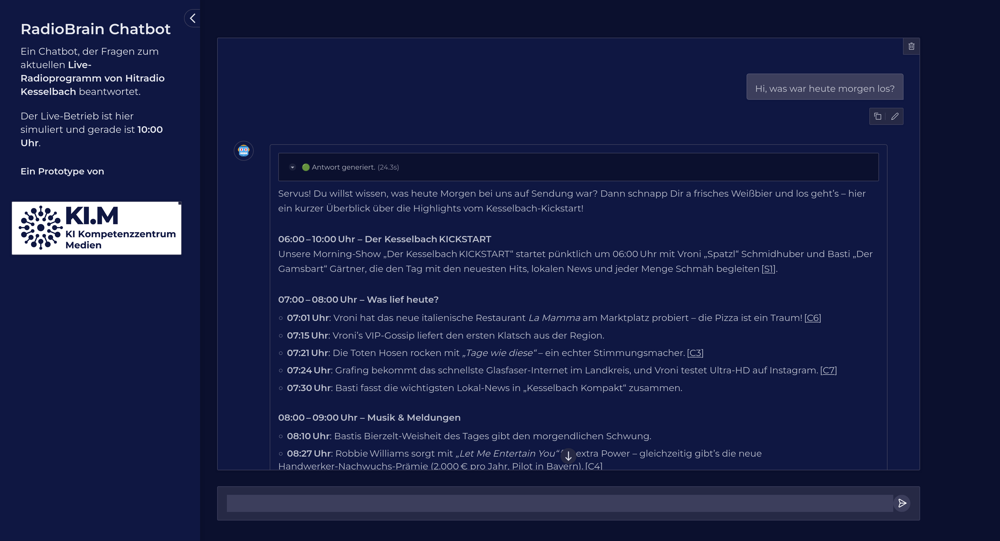

🇩🇪 Deutsch | [🇬🇧 English](README_en.md)

# KI-gestützte vollautomatisierte Hörerkommunikation

> [!IMPORTANT]
> Dies ist eine Proof-of-Concept-Umsetzung einer KI-gestützten, vollautomatisierten Hörerkommunikation für Radiosender. Sie nutzt eine Kombination aus Retrieval-Augmented Generation (RAG) und Großen Sprachmodellen (LLMs), um Hörerinnen und Hörer mit Informationen über den Sender, seine Programme und weitere verwandte Themen zu versorgen.

> [!WARNING]
> Bei diesem Prototyp handelt es sich nicht um produktionsreifen Programmcode. Es handelt sich um einen Forschungsprototypen, der die Fähigkeiten von LLMs und RAG-Systemen im Kontext von Radiosendern demonstriert. Nutzung auf eigene Gefahr.



## Setup
- Sicherstellen, dass Docker und Docker-Compose auf der gewünschten Plattform installiert sind.
- Installation von Poetry: https://python-poetry.org/docs/#installing-with-the-official-installer
- Klonen des Repositories mit git.
- Projektabhängigkeiten installieren: `poetry install`
- Einrichten des erforderlichen LLM-Backend (siehe [LLM HOWTO](LLM-HOWTO.md))
- Sicherstellen, dass das Embedding-Modell `granite-embedding:278m` lokal in Ollama läuft.
- Bearbeiten der `config-kesselbach.yaml`, um sich mit der vLLM- oder Ollama-Instanz zu verbinden, die `gpt-oss:120b` ausführt, und anlegen von Benutzername und Passwort für die Anwendung fest.
-  `make reloaddb` ausführen, um die Datenbank zu initialisieren und die Beispieldaten aus dem Verzeichnis `data` zu laden.

## Anwendung starten
Starten der Anwendung mit:
```bash 
make build
make start
```

Zum Beenden der Anwendung ausführen:
```bash
make stop
```

Die Anwendung ist anschließend unter `http://127.0.0.1:7860` erreichbar.

## Anwendung anpassen

Die Anwendung kann für jeden Radiosender angepasst werden.

### Eigene Daten

Wir stellen Beispiel-Transkripte (bereits gechunkt), Website- und Playlist-Daten im Verzeichnis `data` bereit. Für eigene Daten können diese Dateien durch eigene im selben Format ersetzt werden. Anschließend muss `make reloaddb` ausgeführt werden, um die Datenbank mit Ihren Daten neu zu laden.

### Eigene Prompts

Die Prompts müssen in der Datei `src/llm/prompts.py` angepasst werden. Die Prompts werden zur Generierung der Antworten des LLM verwendet. Die Prompts können an den Stil und Ton des eigenen Radiosenders angepasst werden.

### Eigene feste Daten

An mehreren Stellen der Anwendung können die Inhalte bereitgestellt und Ausgaben konfigurierr werden.

#### Streams
Feste Stream-Link-Daten stellen wir in der Datei `src/streams.json` bereit. Diese Datei ist durch eigene Daten im selben Format ersetzbar. Die Anwendung nutzt diese Daten, um die Stream-Links des Radiosenders zu generieren.

#### Automatische Antworten
Optionen für automatische Antworten im Fall einer Ablehnung gibt es in `src/constants.py`.

#### Basisdaten des Radiosenders
Weitere feste Daten und Konstanten im Zusammenhang mit dem Radiosender gibt es in der `config.yaml`.

## Testsuite ausführen

Wir stellen eine Beispiel-Testsuite bereit, um die Qualität der Anwendung zu messen. Die Testsuite enthält Tests für verschiedene Komponenten der Chatbot-Anwendung, etwa den LLM-basierten Filter und das RAG-System.
Die Datei `eval-config.yaml` kann bearbeitet werden, um die Testsuite anzupassen. Die Testfälle, die Anzahl der Testfälle und die Konfiguration des LLM-basierten Filters sind änderbar. Die mitgelieferte Testsuite ist nicht abschließend und kann um weitere Szenarien erweitert werden. Sie ist ein guter Ausgangspunkt, um die Qualität der Anwendung sicherzustellen. Die für die Tests verwendeten Beispieldaten liegen in `src/eval/` und können leicht um weitere Testfälle erweitert werden.

Die Testsuite ist ausführbar mit (erfordert eine lokale Ollama-Instanz mit dem Embedding-Modell `granite-embedding:278m` sowie eine lokale Version von `gpt-oss:120b`):

```bash
make eval-docker
```

## Lizenz

Dieses Projekt ist unter der MIT-Lizenz lizenziert – siehe die Datei [LICENSE](LICENSE) für Details.
Der Prototyp ist für die Nutzung durch Medienunternehmen gedacht.

Copyright (c) 2026 Medien.Bayern GmbH.

## Mitwirkende
Originalentwicklung durch die Medien.Bayern GmbH ([KI.M](https://www.kim-bayern.de/)) in Zusammenarbeit mit [Tobias Sterbak](https://tobiassterbak.com).

## Ein Projekt des KI-Kompetenzzentrum Medien (KI.M)
Das KI-Kompetenzzentrum Medien (KI.M) ist der zentrale Hub für künstliche Intelligenz in der bayerischen Medienbranche. Wir unterstützen Medienunternehmen dabei, KI-Lösungen zu adoptieren, die rechtskonform, zukunftssicher und auf datensouveräner Infrastruktur aufbauen.

Wir bieten unabhängige Informationen und praxisnahe Demonstrationen der Fähigkeiten und Grenzen von KI in Medienanwendungen. In unserem AI Lab arbeiten wir mit Partnern zusammen, um reale Implementierungen zu erproben. Unsere Machbarkeitsstudien veröffentlichen wir als Berichte auf unserer Website, die technischen Grundlagen und den Code teilen wir hier in unseren Repositories.

Das KI-Kompetenzzentrum Medien (KI.M) ist ein gemeinsames Vorhaben der Bayerischen Landeszentrale für neue Medien (BLM) und der Medien.Bayern GmbH mit Förderung durch die Bayerische Staatskanzlei.

**Mehr erfahren:** [Unsere Website](https://www.kim-bayern.de/)

<a href="https://www.kim-bayern.de/">
  <picture>
    <source media="(prefers-color-scheme: dark)" srcset="assets/RZ_Logo_KIM_RGB_Weiss.png">
    <source media="(prefers-color-scheme: light)" srcset="assets/RZ_Logo_KIM_CMYK_Graphite.png">
    
  </picture>
</a>
